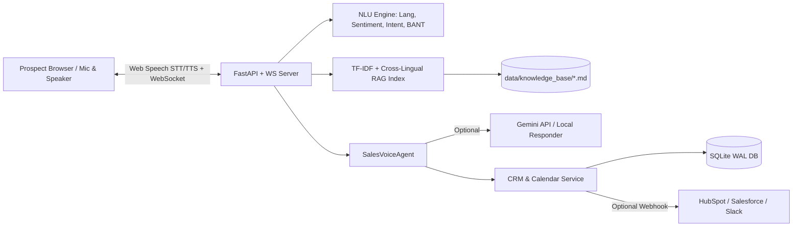

# NexaFlow Autonomous Sales Voice Agent

Real-time AI sales voice agent that handles inbound/outbound discovery calls, retrieves grounded product knowledge via RAG, qualifies leads (BANT), tracks live sentiment, books calendar slots, syncs with CRM, and generates post-call summaries.

## Features

- **Real-time Voice Interaction (STT / TTS):** Browser Web Speech API for streaming speech-to-text and neural/browser TTS with barge-in support, paired with a `/ws/call/{call_id}` WebSocket channel.
- **Contextual & Cross-Session Memory:** Maintains turn-by-turn BANT state (`Need`, `Team Size`, `Budget`, `Authority`, `Timeline`) and recognizes returning prospects by email or company from SQLite.
- **Multilingual Support:** Auto-detects and responds in English, Hindi/Hinglish, and Spanish with cross-lingual RAG query expansion.
- **Grounded RAG Engine:** Indexes Markdown docs in `data/knowledge_base/` with section-level chunking and TF-IDF + keyword scoring (`app/rag.py`), surfacing source citations in real time.
- **Lead Qualification & Sentiment Analysis:** Computes a 0–100 BANT score (`Cold`, `Warm`, `Hot (SQL)`), per-turn sentiment polarity (`-1.0` to `+1.0`), and objection tags (`Pricing`, `Security`, `Integration`, `Timing`).
- **Automated Appointment Booking & CRM Sync:** Checks open calendar slots, prevents double-booking, writes leads/activities/appointments to SQLite, and optionally triggers an external CRM webhook (`CRM_WEBHOOK_URL`).
- **Call Summarisation & Insights:** Generates executive call summaries, next actions, and follow-up email drafts alongside pipeline analytics.

## System Architecture



See [docs/architecture.md](docs/architecture.md) for the detailed sequence flow, 100k-user scaling strategy, security controls, and operational cost estimates, and [REPORT.md](REPORT.md) for the 1-page project report.

## Quick Start

1. **Install dependencies**
   ```bash
   pip install -r requirements.txt
   ```
2. **Configure environment (optional)**
   Copy `.env.example` to `.env`. Leaving `GEMINI_API_KEY` empty runs the full local NLP + RAG + voice pipeline with zero external API dependencies; adding a key enables Gemini response generation automatically.
   ```bash
   cp .env.example .env
   ```
3. **Run the server**
   ```bash
   python run.py
   ```
   Open `http://127.0.0.1:8000` in Chrome or Edge for full Web Speech STT/TTS support.

4. **Run tests**
   ```bash
   pytest -v
   ```

## Project Layout

```text
app/
  agent.py       # Conversation orchestration, memory, Gemini/local response generation
  config.py      # Environment configuration
  crm.py         # Lead pipeline, slot booking, call summary, insights
  database.py    # SQLite schema & session helper
  main.py        # FastAPI REST endpoints & WebSocket handler
  nlu.py         # Language detection, sentiment, objections, BANT extraction
  rag.py         # Markdown chunker & TF-IDF retriever
  schemas.py     # Pydantic request/response models
data/knowledge_base/
  pricing_and_plans.md
  security_and_compliance.md
  integrations_and_api.md
  roi_and_case_studies.md
static/          # Vanilla JS / HTML / CSS dashboard
tests/           # End-to-end API and WebSocket tests
REPORT.md        # 1-page executive & technical report
docs/architecture.md
```

## API Overview

| Endpoint | Purpose |
| --- | --- |
| `POST /api/calls` | Start a new call session (with returning-lead lookup) |
| `WS /ws/call/{call_id}` | Stream live voice/text turns |
| `POST /api/calls/{call_id}/turn` | Process a single conversation turn |
| `POST /api/calls/{call_id}/end` | Finalize call and generate summary + follow-up email |
| `GET /api/calendar/slots` | List open demo slots |
| `POST /api/calendar/book` | Book a calendar slot and update CRM |
| `GET /api/crm/leads` | List leads and qualification scores |
| `GET /api/insights` | Aggregate conversion, language, and pipeline metrics |
| `POST /api/kb` | Add and immediately index a new knowledge base document |
