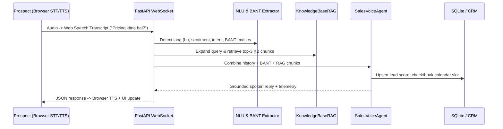

# Architecture, Scaling & Security Design

## 1. End-to-End Call Sequence

## 2. Scaling to 100,000 Users

To support 100,000 registered/active users (~3,000–5,000 peak concurrent voice sessions):

1. **Voice Transport & Streaming Media:**
   - Move from browser-only Web Speech API to **WebRTC (LiveKit)** + **SIP trunking** (Twilio / Exotel) with Voice Activity Detection (Silero VAD) at the edge so barge-in happens in <150 ms.
2. **Stateless Compute & Caching:**
   - Run stateless FastAPI workers on Kubernetes HPA (CPU/concurrency autoscaling).
   - Store active session turns and BANT state in **Redis Cluster** (TTL-backed) instead of querying disk on every turn.
   - Cache frequent RAG answers (pricing, SLA, security FAQs) by tenant + normalized query hash.
3. **Database & Vector Store:**
   - Replace SQLite with **PostgreSQL** (partitioned `calls` and `turns` tables, PgBouncer pooling, read replicas for the Insights dashboard).
   - Replace in-memory TF-IDF with **Qdrant** or **pgvector** using HNSW indexes filtered by `tenant_id`.
4. **Asynchronous Post-Call Pipeline:**
   - Publish `call.ended` events to **Kafka / Redis Streams** so summarization, CRM webhook retries, and analytics aggregation never block live audio workers.

## 3. Data Security & Compliance

- **Transport & Storage:** TLS 1.3 for HTTP/WebSockets, SRTP for WebRTC audio, AES-256 at rest with per-tenant KMS keys.
- **PII Protection:** Redact payment numbers and sensitive IDs before writing transcripts or sending prompts to external LLMs; enforce zero-data-retention API agreements.
- **Access Control:** JWT + RBAC for sales managers vs. reps, plus immutable `crm_activities` audit logs.
- **Residency:** Single-region deployment (`ap-south-1` Mumbai) for India DPDP Act 2023 compliance, with EU/US isolation via tenant routing.

## 4. Infrastructure & Operational Cost Model

| Tier | Workload | Monthly Infra + AI Cost | Unit Cost |
| --- | --- | --- | --- |
| MVP / Demo | Single host, local NLP + Web Speech | \$0 – \$15/mo | < \$0.005 / call |
| Early Growth | 5,000 users, ~25k call mins/mo | ~\$380/mo | ~\$0.015 / min |
| Scale (100k users) | ~500k call mins/mo (LiveKit, Whisper, LLM, TTS, K8s, PG, Redis) | ~\$6,250/mo | ~\$0.0125 / min |
